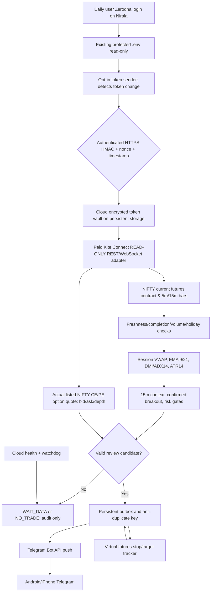
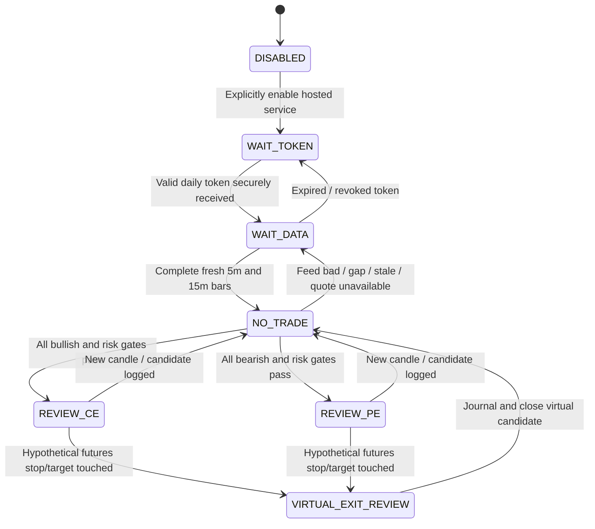

# Complete system architecture — NIFTY 50 Kite Connect → Telegram

## The product goal

Produce **time-stamped, fast, read-only CE / PE paper-review and virtual exit alerts directly to a phone**, without opening Kite charts, Chrome extensions or the trading PC during the trading session. **No auto order placement.** Chart-based indicators cannot guarantee winning trades; edge must be demonstrated by option-level out-of-sample backtests.

The user continues to obtain a Zerodha Kite access token through normal daily authentication. **The existing trading folder is strictly read-only** to this development effort; credentials are not copied to the public repo. The cloud machine must already possess the *new daily access token* before the PC is turned off.

## High-level data flow

## Four operational layers

| Layer | Responsibility | Implementation |
|---|---|---|
| Authentication bridge | Read existing Nirala `.env`, signed one-way token relay, zero writes to protected folder | `cloud_alerts.token_sender`; `cloud_alerts.security`; HTTPS endpoint `/internal/token` |
| Data & integrity | Download live instrument master, select current NFO-FUT dynamically, get 5m/15m OHLCV and bid/ask; reject stale/invalid | `cloud_alerts.kite_readonly`, `contracts`, `models` |
| Decision & risk | Calculate indicators; classify WAIT_DATA/NO_TRADE/REVIEW_CE/REVIEW_PE; test breakouts and stop distance | `indicators`, `signals`; `engine` |
| Alert & state | Private Telegram Bot API, persistent dedupe/outbox, virtual exits, secretless health | `telegram`, `state`, `engine`, `server` |

## Verified adapter contract (no order capabilities)

The cloud read-only API wrapper exposes ONLY:

- `instruments_nfo()`: retrieve NFO instrument master, auto-refresh each session. Validate `segment`, `instrument_type`, `name`, `expiry`, `lot_size`, `instrument_token`, `tradingsymbol`.
- `historical(token, interval, start, end)`: allow only `5minute` / `15minute`, timezone-aware OHLCV. Raw Kite historical array may include a still-forming candle; **exclude until `bar_start + interval + safety_delay <= now`** and require the latest fully completed bar to end on the intended boundary.
- `full_quote(symbol)`: fetch broker-side full NFO quote with current `timestamp`, five-level depth. Verify best BID below ASK, top-level quantities at least one listed lot, spread cap and max 15s quote age.

No order placement, no positions, no holdings, no personal account/profile snapshots, no account balances. The SDK itself offers other capabilities, but the wrapper does not invoke any execution method.

## Five indicators: definition and usage

All five are applied to **liquid current-month NIFTY futures**, not the untraded NIFTY spot index (which can lack tradeable volume):

| Study | Formula / settings | Paper-review role |
|---|---|---|
| Session VWAP | Σ[(H+L+C)/3 × 5m traded volume] / Σ(volume) reset each India exchange session | Price location above/below reference |
| EMA9 | Exponential average of 5m closes, span 9 | Faster direction |
| EMA21 | Exponential average of 5m closes, span 21 | Slower direction |
| DMI / ADX14 | Wilder +DM/−DM, +DI, −DI, smoothed ADX period 14 | Strength **and separate directional sign** |
| ATR14 | Wilder average true range | Futures volatility and risk buffer (not option premium points) |

Wilder smoothing has warmup/seed differences across platforms; compare reference chart and independently calculated values on known complete candles before trusting numerical thresholds. The code uses EMA seeded from first close and Wilder RMA seeded by length-SMA. 70+ 5-minute warmup bars required.

**Actual independent 15-minute context:** use Kite `15minute` historical futures bars. A 15-minute EMA9 above EMA21 confirms only candidate CE direction; below confirms PE. Never call a proxy calculated from 5-minute prices an independent 15-minute chart result.

## Entry decision state machine

**CE review** requires completed 5m futures close above VWAP, EMA9>EMA21, +DI>−DI, ADX>=25 AND rising, actual completed 15m EMA9>EMA21, a close above the highest high of the three previous completed 5m candles, and a valid ATR-adjusted underlying stop. **PE review** reverses the directional signs and breaks the prior-three-candle lowest low. Both require a **real live option** quote with valid ASK/BID/lot/spread/expiry. This is deliberately strict; a zero-alert day can be correct.

**Other hard gates:** 09:30–15:00 IST entry window (research default); IST weekdays; completed 5m end + 8s broker lag; latest 5m expected session boundary; same-day futures candles; recent five-minute contiguity and positive futures traded volume; ≤15-second-old options timestamp; no future timestamps, invalid OHLC or missing 15m confirmation. Exchange holiday handling is data-fail-closed until an official calendar source is integrated.

**Option selection:** choose the nearest **future** NFO-FUT expiry for the direction engine and the nearest **eligible non-same-day** listed NIFTY option expiry (research default), ATM closest strike, actual listed lot size. Do not hard-code expiry day, contract names or lot sizes. Quotes provide ASK for contemplated long entry and BID for sale; never treat the underlying futures close as option premium.

**Exit review:** virtual-only, driven by futures stop/target/time cutoff after a candidate. Stop/target hit in the same candle is ambiguous, so label as risk-first; never claim true fill or actual Kite holdings. A real exit service requires separate explicit holdings authorization and option-price risk design; this repo has neither.

## Latency expectations

**Implemented first stage:** REST 5-minute historical candle verification **≥8 seconds after bar close**, with 15-second polling retries in the first minute until broker publication. After quote and Telegram network time, actual phone delay is variable. This is NOT a low-latency exact entry system.

**Planned second stage:** KiteTicker WebSocket instrument subscriptions for timestamped `full` ticks, 1m and 5m OHLCV aggregation using exchange timestamps and cumulative volume deltas, official REST 5m reconciliation, and real option quote subscription. Allow fast *heads-up* alerts but not a final confirmed entry until the completed bar and reconciliation gates pass. Kite WebSocket documentation currently supports up to 3,000 subscriptions per connection / three connections per API key, but this bot will use only a few instruments and respect all provider limits.

**No negative-latency promise:** indicator confirmation after a 5-minute close may miss initial breakout points. The goal is high integrity first, then measured detection-to-Telegram p50/p95 and missed-boundary rate. No chart or broker endpoint can guarantee a fill at the alerted bid/ask.

## Reliability controls

- **Data integrity:** exchange timestamps (IST), candle end cutoff, contiguous candles, nonzero volume, valid quote spread/depth, recent option timestamp, contract expiry and lot checks. Fail-closed `WAIT_DATA` / `NO_TRADE`.
- **Persistence:** SQLite outbox + unique candle/side event IDs and cloud-managed durable filesystem (one worker only). SQLite is not a scalable multi-instance store; migrate to durable Postgres for multiple workers.
- **Crash/reconnect:** encrypted token vault restores still-valid daily token; REST historical backfill. Explicitly check source/data after restart before resuming alerts.
- **Duplicate safety:** durable event keys; Telegram delivery uses an **at-least-once** outbox. A crash between API acceptance and DB commit can duplicate messages; messages clearly carry candle time. Do not claim exactly-once Telegram delivery.
- **Health:** public `/healthz` reports summary statuses without credentials. A later watcher should send `WAIT_TOKEN`, stale feed, data gap or Telegram delivery alerts to an alternate health channel (so a broken Telegram path is observable).
- **Time and clock:** cloud clock must sync via NTP; tolerate only strict signatures and candle timestamps. Kite access token expires at 06:00 IST next day. Sunday/holiday checks and expiry rules must be validated daily.

## Operational deployment contract

- ONE 24×7 process for the app; configured `ALERTS_ENABLED=true` only after manual acceptance checks.
- Outbound HTTPS to `api.kite.trade`, official Telegram Bot API, and KiteTicker WebSocket when enabled.
- Inbound HTTPS only for `/internal/token` and optionally `/healthz`. Configure a cloud TLS terminator/HTTPS reverse proxy; **never send the token over plain HTTP**.
- Durable/private `/data/nifty-alerts` mount with stable `TOKEN_VAULT_KEY`; keep relay shared secret outside the repository.
- `KITE_API_KEY`, `TELEGRAM_BOT_TOKEN`, `TELEGRAM_CHAT_ID`, `TOKEN_RELAY_HMAC_KEY`, `TOKEN_VAULT_KEY` supplied through hosting platform secret management, **never GitHub**.
- Default state `ALERTS_ENABLED=false`; live broker **order functionality does not exist**.

## Documentation audit: implemented vs planned

**Implemented/testable:** Kite 5m/15m REST adapter, indicator math, candidate strategy, option depth gate, virtual candidate, HTTPS HMAC token relay, encrypted persisted token vault, Telegram outbox, Docker+server, tests.

**Not yet verified:** live cloud deployment, live paid Kite API/option quote ingestion, exchange holiday calendar, live latency, historical win rate and option premium strategy backtest, Telegram notifications from a market-generated candidate.

**Planned:** KiteTicker streaming, persistent multi-process cloud architecture if needed, alert quality analytics, channel failover, per-expiry P&L tracking using historical option bid/ask, walk-forward validation and rollback automation.

External source links: [Kite historical](https://kite.trade/docs/connect/v3/historical/), [Kite quote depth](https://kite.trade/docs/connect/v3/market-quotes/), [Kite WebSocket](https://kite.trade/docs/connect/v3/websocket/), [Kite user sessions](https://kite.trade/docs/connect/v3/user/).
