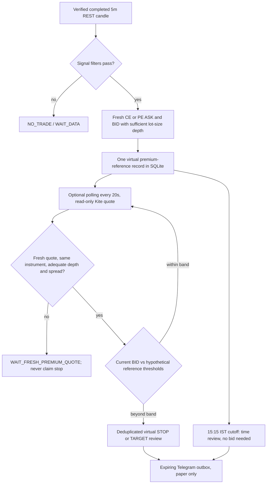

# P7 — Virtual NIFTY option-premium exit-review monitor

**Version:** 2026-10-19. **Status:** implemented and tested offline, **not live-deployed**. **Not a broker order, holding, fill or an audited profitable strategy.**

## Why this was necessary

The original entry prototype correctly checked futures structure and actual CE/PE market depth, but its virtual exit monitor watched only NIFTY **futures** stop and target levels. Option premiums can diverge because of theta, IV changes, gamma, and spreads. Therefore futures price alone cannot predict what a bought CE/PE is worth.

This opt-in research enhancement observes the **same listed option's executable top BID** after an entry-review signal. Its only output is an informational Telegram **VIRTUAL OPTION EXIT REVIEW**. No actual portfolio/holdings/order endpoint is accessed, and the system cannot know what you paid or whether you bought anything.

## Data flow



## Exact rules

| Attribute | Prototype behavior |
|---|---|
| Entry reference | **ASK quoted when an entry-review alert was produced**, not an executed buy |
| Monitored option | Exactly the original listed NIFTY CE/PE symbol, expiry, instrument token and lot size |
| Monitored sell value | **BID**, never last-traded price (LTP) or an inferred Greek-based premium |
| Stale data | Reject quote timestamp older than 15 seconds or future-dated; keep candidate, send no false alert |
| Liquidity | Both bid and ask depth must cover one listed lot; bid positive, ask greater than bid; spread <=2% |
| Reference stop hypothesis | BID <= 80% of the reference ASK (20% hypothetical drawdown) |
| Reference target hypothesis | BID >= 140% of the reference ASK (40% hypothetical gain) |
| Intraday cutoff | From 15:15 IST, emit a virtual **TIME** review even if option quote is unavailable; clearly indicate no bid |
| Midnight | Old virtual candidate removed; never carry paper state to a new session |
| Repeated signals | Only **one virtual candidate active**; later entries cannot silently overwrite the old reference |
| Duplicate exit | Durable event IDs and persistent outbox; normal retries are at-least-once, not mathematically exactly-once |
| Real orders | **None**; no Kite orders, positions or holdings endpoints anywhere |

**The 20%/40% percentages are arbitrary, explicit research hypotheses, not optimized option stops or guaranteed reward/risk.** Even the 40% paper target may be unrealistic. Before any real use, evaluate by strike, IV, expiry, slippage, fees and net options P&L. Large price gaps can skip any real stop. **There is no automatic execution even if the message says EXIT REVIEW.**

## Enable only when ready

Add to the **cloud host private environment**, not the public GitHub or protected Nirala trading `.env`:

```env
PAPER_PREMIUM_TRACKING_ENABLED=false
```

It defaults to `false`. Turning it `true` starts an optional read-only quote check in the worker's existing single process (at most every 20 seconds during the market); it **does not** create or fetch an actual position. It uses the existing daily token already securely handed off to the cloud. There is no need for the Kite API secret in the cloud.

This only becomes meaningful after the cloud host is approved, persistent encryption is configured, the Telegram phone TEST passes and option quote freshness is confirmed in a real session. No such production or phone test has been performed for this module yet.

## Safety limitations

1. **Not a position monitor:** A signal's quoted ASK is not a confirmed fill. The quoted later BID is not a realized exit. Net P&L must not be reported from these references.
2. **Quote polling, not ticks:** Polling every 20 seconds can miss sub-second premium reversals; availability, network latency and Kite API timing vary. The REST 5m candle remains the ONLY authority for **entry** decisions.
3. **Exit conflict:** A futures 5m stop/target may trigger first, or the premium BID may trigger first; the worker removes the virtual candidate after the first recorded exit review. It must not pretend two real orders occurred.
4. **Service outage:** Events more than 180 seconds old are expired rather than being delivered as stale opportunities. Crashes immediately after Telegram accepts a message may still cause duplicate messages; timestamps are mandatory.
5. **No trading claims:** Win rate, accuracy, profit factor and realized drawdown are unknown until independently validated using actual option fills/quotes.

## Test evidence

Local synthetic tests cover: valid reference creation, mismatched/expired/corrupt symbols, quote freshness, BID stop and target checks, cutoff with no quote, expiry cleanup, deduplication, disabled mode with zero broker calls, and a full simulated entry-review → virtual option-stop review flow. **88/88 total Python tests pass** across the project at the time of publication.

**Acceptance still outstanding:** live NIFTY option depth over multiple market sessions; phone receipt timestamp; missed-quote metrics; cloud restart continuity; walk-forward option return tests; hosting and token handoff in an approved server.
