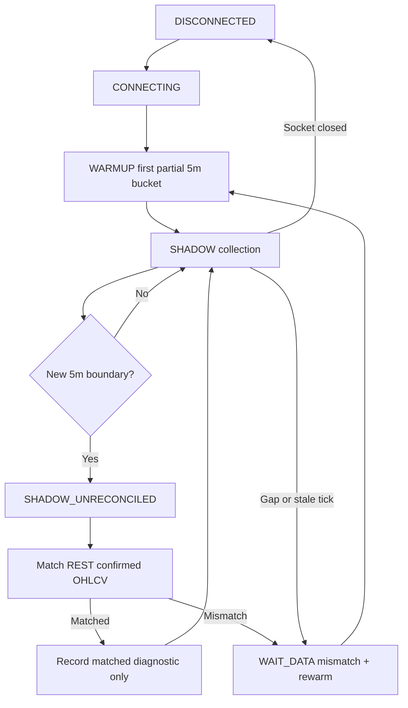

# P6 – KiteTicker WebSocket shadow-data design

**Version:** 2026-10-19 — **implementation status: synthetic-tested, shadow-only and NOT connected to the cloud signal engine.** No real Kite WebSocket connection was opened during these tests. No hosting deployment or charge was made.

## Why add a stream?

The Chrome chart extension depended on near-close screen sampling and could reset its five-minute history due to background throttling, cursor movement, or stale DOM values. Official Kite Connect provides real-time quote ticks and historical market-data candles, allowing a laptop-independent service (once hosted and authenticated) to avoid a browser entirely. However, real-time ticks **do not inherently provide exchange-confirmed 5-minute OHLCV**: tick snapshots may miss intra-interval highs/lows and volume changes.

## Components, order, and trust levels

1. **Current-contract resolver:** read the NFO instrument list and select active NIFTY futures by expiry/token. Reset on expiry rollover or missing instrument. Same broker account API may only be used for read operations.
2. **Read-only KiteTicker connection:** `cloud_alerts.streaming.KiteTickerShadow` subscribes to **only** the active NIFTY futures instrument in `MODE_FULL`; callbacks never access order APIs. Access token and API key remain memory-only here.
3. **Tick admission:** require matching instrument token, usable `exchange_timestamp`, sane positive `last_price`, nonnegative **cumulative** `volume_traded`, correct IST session, source age <=10 seconds, monotonic timestamps and non-decreasing cumulative volume. Out-of-order, gaps >45 seconds, reconnects and volume resets invalidate the partial bar.
4. **Shadow 5-minute aggregation:** accumulate price samples into 5-minute OHLC and derive bar volume by subtracting consecutive cumulative tick volumes. Discard initial partial bucket on startup or reconnect; require a tick within 5 seconds before the interval boundary; do not synthesize missing ticks or patch holes with repeats.
5. **REST reconciliation:** `reconcile_stream_bar` compares shadow OHLCV to the authoritative historical `5minute` REST candle with timestamp, price and volume tolerances. Log mismatch reasons **without access keys, account details or raw tokens**. The shadow result itself has status `SHADOW_UNRECONCILED` and is NEVER fed to the live-alert decision engine in this phase.
6. **Only independently confirmed broker REST candles** currently feed the five-indicator strategy, with a separate 15-minute REST confirmation and a fresh real option bid/ask check. Stage the real-time stream behind a **disabled-by-default shadow flag** and collect quality evidence before promotion.

## State machine

## Key safety contracts

- **No direct trading/position execution.** No `place_order` / `modify_order` / `cancel_order` integrations are present.
- **First bucket is partial** without knowing initial cumulative volume. Discard even if many updates arrive before boundary.
- Duplicate tick `timestamp + price + total volume` does not manufacture bar volume.
- On reconnect or session change, clear the warmup baseline rather than interpolating missing data.
- A shadow candle cannot become authoritative merely because its time boundary passed. Test a separate reconciliation rule against complete REST candles and carry quality metadata.
- Kite may provide naive Indian local timestamps; interpret naive times as IST only at the dedicated broker gateway. Never do naive timezone comparisons elsewhere.
- Instrument/contract rollover must not reuse the previous token or cumulative volume baseline.
- Never use the futures ATR as a stop in rupees for an option contract.

## Synthetic test coverage

`tests/test_streaming.py`: initial partial bar dropped, continuous synthetic tick aggregation, out-of-order packets, stale or future tick rejection, gap recovery, cumulative volume reset, duplicate packets, session hours, disconnected state, explicit REST reconciliation mismatch, and mock full-mode subscription.

`tests/test_scheduler.py`: no pre-boundary REST call, bounded three attempts for each 5-minute boundary, late wake does not burst requests, IST and trading-session guards.

`tests/test_stale_delivery.py`: a queued historical BUY alert older than 180 seconds is expired, not delivered late; a fresh alert is delivered only once in the normal success path.

**Test limitations:** synthetic simulated data is not evidence that Kite's live WebSocket reproduces exchange OHLCV. A single `.tick` structure is not proof of normal market conditions. The actual Kite paid account, rate-limits, heartbeat, reconnections and phone delivery latency still require separately authorized integration tests.

## Next integration stage (not yet done)

- Add a **shadow-runner** lifecycle to the cloud service that starts a WebSocket only when a valid daily token and current NFO futures instrument are available, and runs alongside the existing REST worker without influencing notifications.
- On every completed REST candle, compare timestamp, OHLC and volume to the shadow bar; store reconciliation counts and sample dates in durable state.
- Test 5+ market sessions, chart holidays, expiry rollover, network interruptions, late starts and token expiration; report percentage matched / discrepancies and p50/p95/p99 tick-to-phone delays.
- Only after formal data-quality evidence consider a faster tick-driven **candidate notification**, still gated by separate actual-option quote, risk and non-execution rules.

## Cloud-host requirement

Connected Render services visible during this review were **free web services**. They are **not an acceptable reliable always-on host** for the strategy without provider-confirmed guarantees about CPU suspension, WebSocket lifetimes, persistent encrypted storage and service eligibility. No service has been deployed or changed. Choose a suitable host with explicit user approval and incremental cost authorization first.
